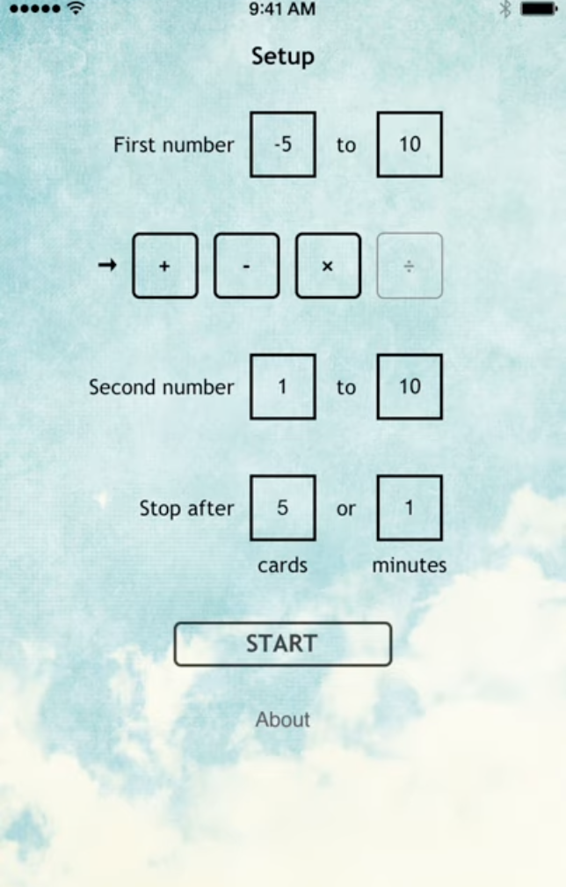
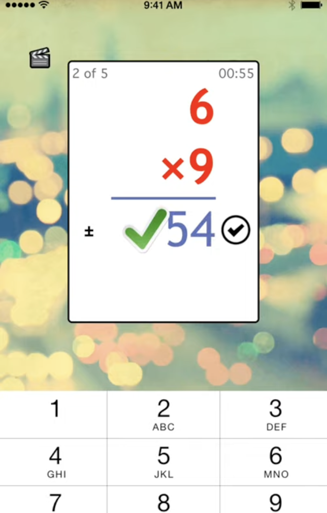
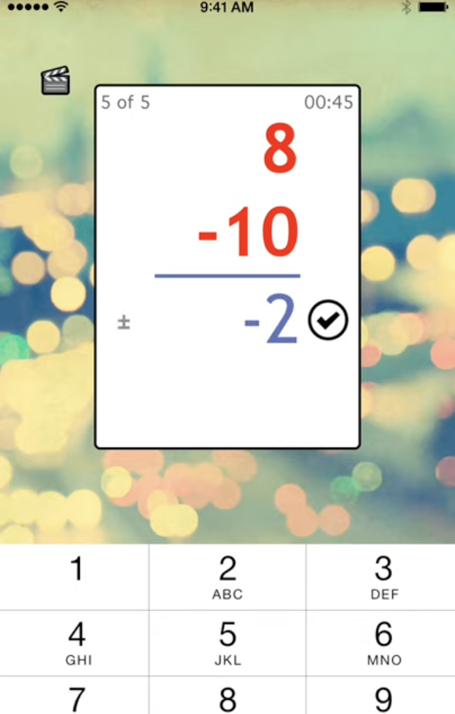
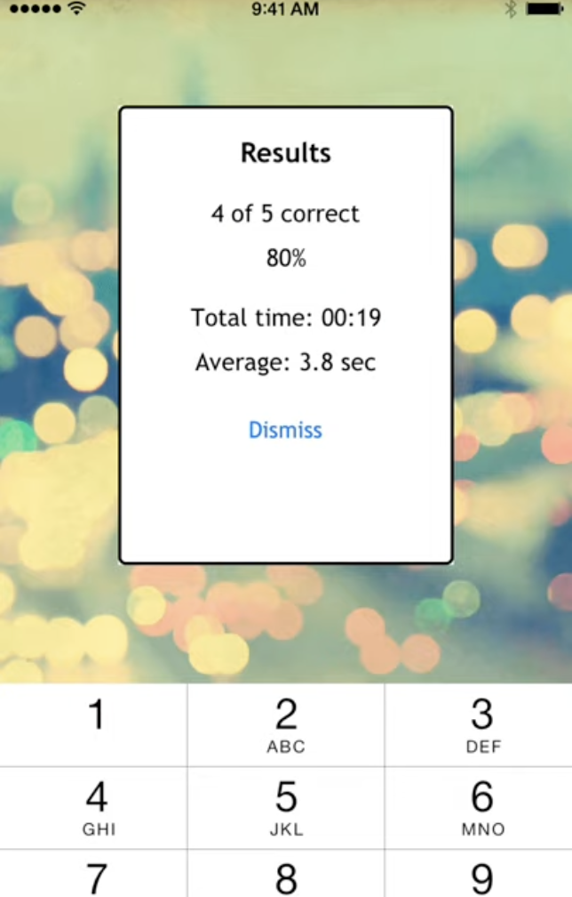

# Math Cards

Animated math flash cards for elementary school students (aka my kids), and my first Swift app.

<!-- TODO: add a short hero GIF at assets/math-cards.gif above this thumbnail, and keep the thumbnail as the full demo -->

**Role:** designer, developer, QA, release, and marketing (solo) · **Built:** 2014–2015 · **Studio:** Round Trip Software
**Status:** no longer on the App Store · **Stack:** Swift, UIKit, XCTest

- [Demo video](http://www.youtube.com/watch?v=CShJdcc51pg)
- [More info on the Round Trip Software site](https://roundtripsoftware.wordpress.com/continuous-math-flash-cards/)

## The idea

My daughter was struggling with math fluency, so I built her something that felt more like a game than a drill. I gamified the practice with little animations and positive feedback.

I also wanted to learn Swift, which had just come out, so this was a deliberate excuse to build a new app in it.

## What it does

- Practice with addition, subtraction, multiplication and division, in any combination
- Get animated, positive feedback as you answer, such as a big green check mark for a correct answer
- Choose the number range for each side of the problem, so a younger child can start with 1 to 5 and move up, including negative numbers for older kids
- Run a session by number of cards or by time limit, with a countdown timer and a running card count
- Get a results report at the end: total answered, percent correct, total time and average time per card
- Your choices are remembered between sessions

## How it's built

- **Swift and UIKit, about 1,700 lines of app code.** The first source files are dated October 2014, a few months after Swift was introduced.
- **A small, testable model layer.** Questions and operations are plain types (`MathQuestion`, `MathOperation`), and random question generation takes the user's ranges and operations as parameters.
- **Unit tests for the logic.** Four XCTest files cover the question math, helpers and extensions.
- **Settings stored with `UserDefaults`**, behind a small persistence class with sensible defaults.
- **Custom UI controls** for the answer entry, countdown timer and card counter.
- **Kept alive over time:** moved from SVN to Git in 2015 and upgraded to Xcode 7.3 in 2016.

## What I learned

A practical app, written quickly in Swift's early days, that showed what I could ship and helped me move into full-time app development. [Read my retrospective](https://mentalbreaktown.blog/2022/04/11/what-you-can-see-here-is-that-i-was-learning/).

## Screenshots

